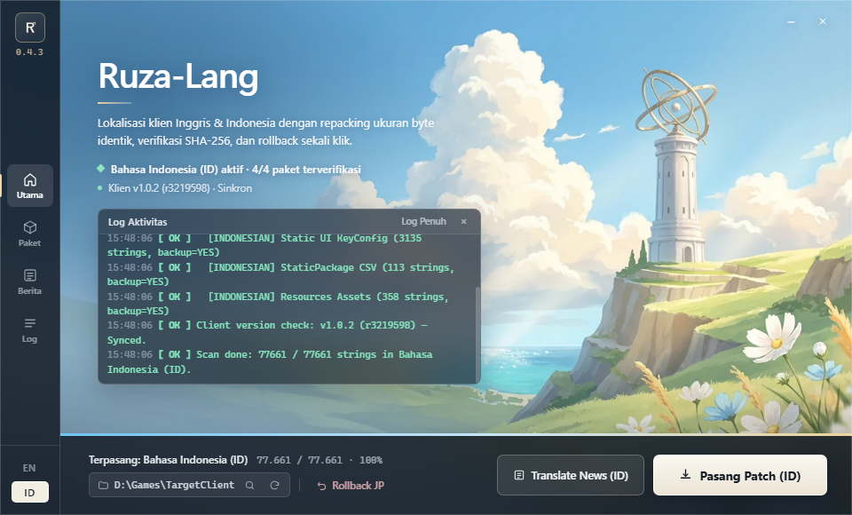

# Ruza-Lang (`v0.4.3`)

[](https://github.com/notnedar/ruza-lang/actions/workflows/release.yml)

> [!IMPORTANT]
> **Tested & Working In-Game · Vibe-Coded Educational Project**
> - Confirmed **tested and working in-game** on the current build.
> - This is a **vibe-coded educational project** — future client updates or hotfixes may still cause quirks or breaking changes. Always keep backups (`_ENPatchBackup\`) and use at your own risk.

An educational desktop localization & asset-repacking study project demonstrating bilingual string patching (**English** & **Bahasa Indonesia**), exact-size compressed bundle repacking, SHA-256 verification, and safe one-click rollback.

> **Pre-built Windows binary:** download `RuzaLangPatcher.exe` from [Releases](https://github.com/notnedar/ruza-lang/releases).

---

## What's New in `v0.4.3`

- **Cleaner Launcher Typography & Header Polish:** Removed all tracked uppercase UI eyebrows across Home and sub-views (`Packages`, `News Cache`, `Execution Log`) and stripped the status dot from the Home Activity Log header for a calmer, distraction-free interface.
- **Zero `.WebView2` Folder Clutter Next to `.exe` (`v0.4.2`):** Redirected Edge WebView2's runtime profile cleanly to `%LOCALAPPDATA%\RuzaLang\WebView2` so running `RuzaLangPatcher.exe` never creates a `RuzaLangPatcher.exe.WebView2` folder on your Desktop or Downloads.
- **Always-Visible Home Live Activity Log (Collapsible):** Live scan, **Install Patch**, **Translate News**, and **Rollback JP** logs now appear directly in the lower-left Home launcher canvas from launch (with one-click hide `×` / `Show Log` & `Full Log`).
- **Client Version Sync Check (Non-Blocking):** Automatically reads the installed client version, resource manifest revision, and build GUID (`v1.0.2 · r3219598`) alongside package SHA-256 verification. Displays a clean sync status on Home & **Files**; if a future game update introduces a version mismatch, it recommends waiting for a patcher update via a soft confirmation dialog while still letting you choose **Install Anyway**.
- **Frameless PC Game Launcher UI (`v0.4.0`):** `960×580` frameless desktop launcher with Windows 11 native rounded corners, custom draggable top bar (`—` / geometric `✕`), slim frosted left rail (`Home` · `Files` · `News` · `Log` + `EN`/`ID`), original painted scenic hero canvas, bottom action dock, and frosted-glass sub-pages.
- **Includes all `v0.2.1` & `v0.2.0` upgrades:**
  - **UI Fit Pass (`EN` & `ID`):** Tightened quick-menu labels, event sidebar tabs, chapter headers, and banner descriptions + conservative TextMeshPro `<size=80%>` scaling on ultra-wide short prefab labels (`116` EN / `50` ID) to prevent overlap and `...` truncation.
  - **Dedicated `Translate News (EN / ID)` Button:** Translates **16 cached in-game announcement HTML pages** (`AppData\LocalLow\...\HTTPCache`) with automatic `_NewsPatchBackup\` rollback and `ETag`/`Last-Modified` preservation.

---

## Preview & Usage Demo

### Live Usage Walkthrough (`EN` ↔ `ID` + Rewrite Progress)


### Interface Screenshots

| English (`EN`) | Bahasa Indonesia (`ID`) |
| :---: | :---: |
|  |  |

### In-Game Samples (`EN`)

| Character Screen | Star Journey Record |
| :---: | :---: |
|  |  |


---

## Features / Fitur

- **Bilingual Switch (`EN` / `ID`):** Toggle between **English** and **Bahasa Indonesia** directly inside the GUI — switches both the app interface and the target localization pack.
- **4-Store Localization Pipeline (`77,661` strings):**
  - `VStringPool` — `74,055` strings (dialogue, quests, skills, items, settings)
  - `Static UI KeyConfig` — `3,135` strings (prefab labels, buttons, headers, notices)
  - `StaticPackage CSV` — `113` strings (startup & updater messages)
  - `resources.assets` — `358` strings (fallback startup & SDK UI)
- **Dedicated Translate News (`EN` / `ID`) Button:** Translates cached in-game announcement HTML pages (`16` pages in `AppData\LocalLow\...\HTTPCache`) with automatic backup in `_NewsPatchBackup\` while preserving HTTP `ETag`/`Last-Modified` headers and syncing BestHTTP `Library` body lengths.
- **Process Guard:** Checks whether target client/launcher processes are running and blocks patching, news translation, or rollback until they are closed.
- **One-Click Rollback:** Saves verified original backups to `_ENPatchBackup\` (and `_NewsPatchBackup\` for cached announcements) before patching and restores exact original SHA-256 hashes anytime.
- **Exact-Size Asset Repacking:** Preserves identical file byte sizes across all 4 targets using exact-size LZ4HC tuning and round-trip integrity checks.
- **Live Verification Log & Progress Rail:** Real-time rewrite progress (`0 → 77,661`) along the launcher dock, per-package SHA-256 verification rows in the `Files` view, and a clean execution ledger in the `Log` view.

---

## Usage / Cara Pakai

1. Make sure the target client and launcher are completely closed.
2. Download and run `RuzaLangPatcher.exe` from [Releases](https://github.com/notnedar/ruza-lang/releases).
3. Check the auto-detected target folder in the bottom dock (or click the path / open **Files** to browse manually).
4. Choose **`EN`** (English) or **`ID`** (Bahasa Indonesia) at the bottom of the left rail.
5. Click **Install Patch** in the bottom-right dock and wait ~2 seconds for verification to complete.
6. *(Optional)* After opening the in-game News/Announcements screen at least once, close the client and click **Translate News (`EN` / `ID`)** to translate cached in-game announcements.
7. Click **Rollback JP** at any time to restore original files (including cached News if backed up).

---

## Repository Layout

- `src/` — Standalone desktop launcher & frameless WebView2 UI (`src/ui/index.html`, `src/ui/hero.webp`)
- `resources/` — Compressed bilingual localization payloads (`EN` + `ID`)
- `patches/` — Human-readable JSON translation dictionaries (`EN` + `ID`)
- `tools/` — Node.js scripts for payload packing and asset repacking research

---

## Build Transparency & Verification

Official release binaries are compiled directly on **GitHub Actions** (`windows-latest`) from this public source tree via [`.github/workflows/release.yml`](.github/workflows/release.yml) and signed with **GitHub Artifact Build Provenance Attestation**.

You can verify that a downloaded `RuzaLangPatcher.exe` was built directly by GitHub Actions from this repository:

```powershell
gh attestation verify RuzaLangPatcher.exe --owner notnedar
```

---

## Build from Source

Requires Windows 10/11 (x64), MSVC build tools, and Edge WebView2 Runtime:

```powershell
cargo build --release
```

Output executable: `target\release\RuzaLangPatcher.exe`

---

## Disclaimer

This repository is strictly an **educational project** created to study binary serialization, compression, and localization tooling. No copyrighted or proprietary assets are distributed here.
