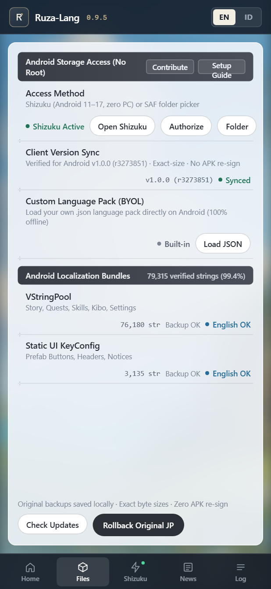
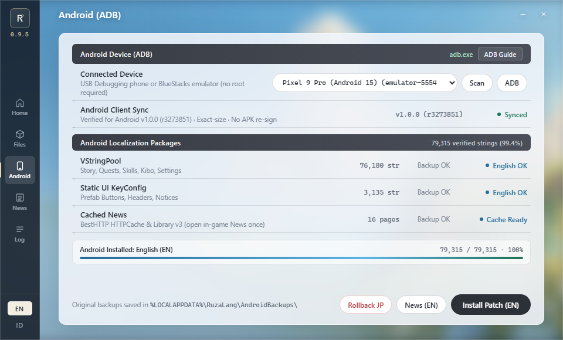
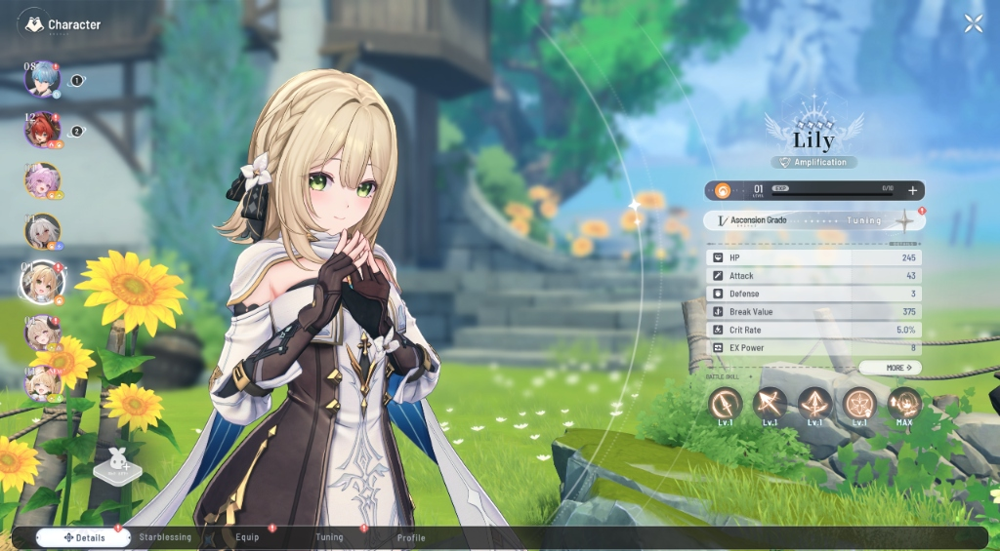
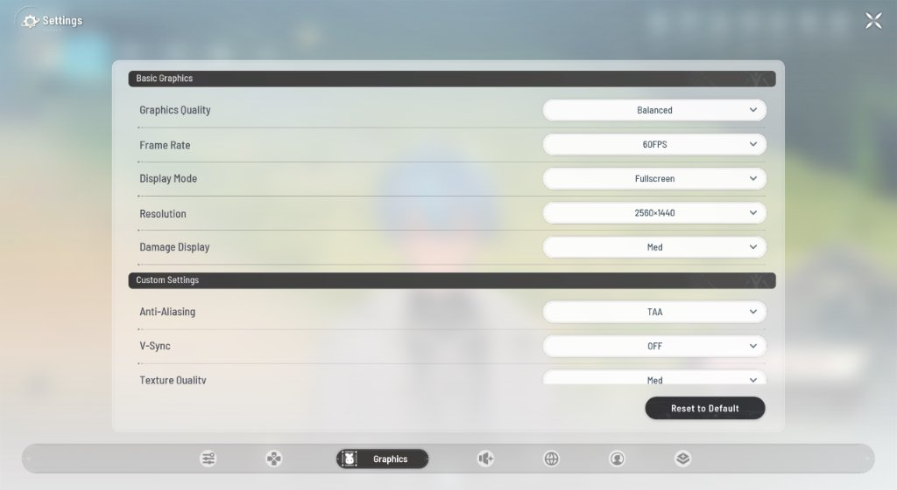

# Ruza-Lang (`v0.9.5`)

🌐 **Language:** **English** | [Bahasa Indonesia (`README_ID.md`)](README_ID.md)

[](https://github.com/notnedar/ruza-lang/actions/workflows/release.yml) [](https://github.com/notnedar/ruza-lang/actions/workflows/security.yml) [](https://scorecard.dev/viewer/?uri=github.com/notnedar/ruza-lang)

> [!IMPORTANT]
> **Tested & Working In-Game (PC & Android) · Vibe-Coded Educational Project**
> - Confirmed **tested and working in-game** on both PC and Android clients (standalone APK & PC/ADB).
> - This is a **vibe-coded educational project** — future client updates or hotfixes may still cause quirks or breaking changes. Always keep automatic backups (`_ENPatchBackup\` / local APK backups) and use at your own risk.
> - **About the OpenSSF Scorecard badge:** All core security checks (`SAST/CodeQL`, `Token-Permissions`, `Pinned-Dependencies`, `Dangerous-Workflow`, `Dependency-Update-Tool`, `Security-Policy`, `License`) score **10/10** — the aggregate score is lowered mainly by new solo-repo criteria (repo age < 90 days, single contributor, direct commits, and non-Windows transitive warnings). Click the badge or see [`SECURITY.md`](SECURITY.md) for full details.

An educational localization & asset-repacking suite demonstrating exact-size string patching (**English**, **Bahasa Indonesia**, and **Bring Your Own Custom Language Packs**) for **Windows PC** and **Android** (both a **standalone zero-PC Android APK** and **PC-to-Android ADB**), SHA-256 verification, and safe one-click rollback.

> **Pre-built official binaries:** download **`RuzaLangPatcher.exe`** (Windows PC) or **`RuzaLangPatcher.apk`** (Standalone Android — 100% no PC, no root!) from [Releases](https://github.com/notnedar/ruza-lang/releases).

---

## What's New in `v0.9.5`

- **Dedicated Android `Shizuku` Menu & Live Status (`RuzaLangPatcher.apk`):** Added a direct **`Shizuku`** tab in the Android navigation bar with a live status dot (Green = Connected, Amber = Needs Permission / Blocked, Red = Stopped / Not Installed), 1-tap **Open Shizuku** & **Authorize** controls, a built-in FAQ explaining Shizuku is only needed while patching, and automatic live status refresh when switching back from the Shizuku app.
- **Compact Font `?` Info Tooltip & Security CI Suite (`v0.9.4`):** Added a `?` help icon next to `Compact font (PC Only)` with a plain-language tooltip (`EN` & `ID`), plus **GitHub CodeQL**, **Dependabot**, **OpenSSF Scorecard**, automated **ClamAV** release scans, direct **VirusTotal** links, [`SECURITY.md`](SECURITY.md), and `node tools/verify-resources.mjs`.
- **Raw `<size=...%>` Tag Hotfix (`EN` & `ID` · `v0.9.3`):** Removed all `167` injected percentage `<size=NN%>` tags across `Static UI` and `VStringPool` (`EN` & `ID`) that rendered literally on non-RichText controls (such as the Gacha `10x Observe` / `10x Observasi` buttons), and fixed a duplicated Indonesian label (`Pemeliharaan`).
- **Optional Compact PC UI Font (`Compact font (PC Only)` · `v0.9.2`):** Toggleable checkbox directly above **Install Patch** on Home. Swaps Latin UI glyphs across all active PC font packages to **Barlow Semi Condensed** (~15% narrower for tighter English/Indonesian UI fit) while keeping all original CJK glyphs intact (zero `□□□` missing boxes), exact `0 B` file size delta, automatic original backups, and automatic restore when unchecked or on **Rollback JP**.
- **Loading Screen Tip Wrapping (`EN` & `ID` · `v0.9.2`):** Wrapped all long loading-screen tips onto 2 balanced lines so text no longer overflows off-screen horizontally, and aligned official terms (`Astral Insight`, `Star Journey Record`).
- **Gacha UI Fit Fixes & Android HyperOS Shizuku Improvements (`v0.9.1`):** Fixed truncated Gacha buttons (`1x Observe`, `10x Observe`, `Exchange`, `Details` in `EN` & `ID`), added `2s` Shizuku `UserService` polling + HyperOS/ColorOS guidance, and published [`README_ID.md`](README_ID.md).
- **Hotfix-Proof Universal Engine & Full `r3273853` / `r3273851` Support (`v0.9.0`):**
  - **Dynamic Bundle Auto-Discovery:** Automatically locates the active `VStringPool` (`raw_base_package`) and `Static UI KeyConfig` (`default_package`, via constant Unity CAB signature) `.r` files on both PC and Android (Shizuku, SAF, Direct, and ADB) — zero hardcoded `.r` filenames or sub-bundle byte offsets!
  - **Universal Content-Hash Matching (`RZV2`):** Matches all **`76,180`** `VStringPool` strings by `FNV-1a64` content hash + byte length with dynamic contiguous span repacking across builds (`r3219596`, `r3219598`, `r3273851`, `r3273853`, and future resource hotfixes!) — removing the legacy platform remap table completely.
  - **Smart Hotfix Version Sync:** Automatically syncs compatible resource hotfixes (eliminating false `Client Version Mismatch` popups on `r3273851` / `r3273853` and future minor hotfixes) while preserving per-bundle state tracking (`_ruza_state.json`) and `<bundle>.original` backups.
- **Full `r3273853` / `r3273851` Hotfix Localization (`+2,125` New Strings in `EN` & `ID`):**
  - Translated all **`2,125`** new strings introduced in the latest hotfix into both **English (`EN`)** and **Bahasa Indonesia (`ID`)**, raising total coverage to **`79,786` strings on PC** and **`79,315` strings on Android (`99.4%`)**.
  - Tightened `Static UI KeyConfig` Indonesian labels to fit cleanly inside the tighter `r3273853` LZ4HC exact-size budget with verified free slack on both `EN` and `ID`.
- **Previous Highlights (`v0.8.1` & `v0.8.0`):**
  - **Live Process-Guard Button Locking (`v0.8.1`):** Automatically disables **Install Patch**, **Translate News**, and **Rollback JP** (showing `Close Game First` / `Tutup Game Dulu`) while the target game or launcher is running on PC, Android ADB, and Standalone APK.
  - **Bring Your Own Language Pack (`BYOL` · `v0.8.0`):** Load any custom `.json` language pack directly inside **Files → Custom Language Pack → Load JSON** (with `Custom OK` state tracking, base inheritance `en`/`id`/`jp`, flat dictionary drop-ins, and [`CONTRIBUTING.md`](CONTRIBUTING.md) + `node tools/validate-pack.mjs`).
  - **Combat Timing Terminology & Official Glossary (`v0.8.0` / `v0.7.1`):** Natural action-RPG timing terms (`Perfect Guard`, `Perfect Parry`, `Perfect Dodge`, `Parry Window / Celah Parry`), `3,362` official global terms, and `100%` non-root standalone Android APK.

---

## Preview & Usage Demo

### Standalone Android APK (`RuzaLangPatcher.apk`)

| Portrait Phone (Home) | Portrait Phone (Files & Sync) |
| :---: | :---: |
|  |  |

### Desktop Live Usage Walkthrough (`EN` ↔ `ID` + Rewrite Progress)


### Desktop Interface Screenshots

| English (`EN`) | Bahasa Indonesia (`ID`) |
| :---: | :---: |
|  |  |



### In-Game Samples (`EN`) — Original Font vs. Compact Font (PC Only)

| Original Font (Default) | Compact Font (`Barlow Semi Condensed` · PC Only) |
| :---: | :---: |
|  |  |
|  |  |


---

## Features / Fitur

- **Bilingual Switch (`EN` / `ID`):** Toggle between **English** and **Bahasa Indonesia** directly inside the GUI (Windows & Android) — switches both the app interface and the target localization pack.
- **PC 4-Store Localization Pipeline (`79,786` strings):**
  - `VStringPool` — `76,180` strings (dialogue, quests, skills, items, settings — hotfix-proof content-hash matched)
  - `Static UI KeyConfig` — `3,135` strings (prefab labels, buttons, headers, notices — dynamically discovered)
  - `StaticPackage CSV` — `113` strings (startup & updater messages)
  - `resources.assets` — `358` strings (fallback startup & SDK UI)
- **Android 2-Bundle Pipeline (`79,315` strings · `99.4%` coverage):** `VStringPool` (`76,180`) + `Static UI KeyConfig` (`3,135`) + Android Cached News (`EN` / `ID`) — zero root, zero APK re-signing, and automatic hotfix sync.
- **Dedicated Translate News (`EN` / `ID`) Button:** Translates cached in-game announcement HTML pages (`16` pages in `HTTPCache` + `Library v3`) with automatic backup restore on Rollback.
- **Process Guard:** Checks whether target client/launcher processes are running (PC & Android) and blocks patching, news translation, or rollback until closed.
- **One-Click Rollback:** Saves verified original backups automatically before patching and restores exact original SHA-256 hashes anytime.
- **Exact-Size Asset Repacking:** Preserves identical file byte sizes across all targets using exact-size LZ4HC tuning and round-trip integrity checks.

---

## Usage / Cara Pakai

### Option A — Standalone Android Phone (No Laptop, No Root!)
1. Finish downloading the in-game additional data on Android, then **completely close (Force Stop) the game**.
2. Download and install **`RuzaLangPatcher.apk`** from [Releases](https://github.com/notnedar/ruza-lang/releases).
3. **Grant `Android/data` access (Android 11–17, zero PC, zero root):**
   - **Recommended — Shizuku via Wireless Debugging:**
     1. Install official **[Shizuku](https://shizuku.rikka.app/download/)** (Google Play or GitHub).
     2. Enable **Developer Options → Wireless Debugging** on your phone.
     3. Open Shizuku → tap **Pairing** → enter the 6-digit code in the notification → tap **Start**.
     4. Open **Ruza-Lang** → tap **Setup Access** → tap **Authorize Shizuku** → choose **Allow all the time**.
   - **Alternative — Folder Picker (SAF) / Direct Storage:** Works directly on Android 8–12 or compatible emulators without Shizuku (100% non-root). *(Note: Android 13–17 blocks SAF from accessing `Android/data`, so use Shizuku or Option C below.)*
   - **Xiaomi / POCO / Redmi (HyperOS) & OPPO / Realme Shizuku Tip:** If Shizuku is running but Ruza-Lang still shows *Authorize Storage Access First*:
     - **Xiaomi / POCO (HyperOS):** Enable **USB debugging (Security settings)** in Developer Options, set **Battery → No restrictions** + **Autostart ON** for both **Shizuku** and **Ruza-Lang**, and lock Shizuku in Recent Apps.
     - **OPPO / OnePlus / Realme:** Enable **Disable permission monitoring** near the bottom of Developer Options.
4. Choose **`EN`** (English) or **`ID`** (Bahasa Indonesia) in the top bar (or left rail on tablets/landscape).
5. Tap **Install Patch (`EN` / `ID`)** — takes ~3 seconds with automatic local backups and full SHA-256 verification.
6. Tap **Rollback JP** anytime to restore original files (including cached News if backed up).

### Option B — Windows PC Client
1. Make sure the target client and launcher are completely closed.
2. Download and run **`RuzaLangPatcher.exe`** from [Releases](https://github.com/notnedar/ruza-lang/releases).
3. Check the auto-detected target folder in the bottom dock (or click the path / open **Files** to browse manually).
4. Choose **`EN`** or **`ID`** at the bottom of the left rail and click **Install Patch**.
5. *(Optional)* After opening the in-game News/Announcements screen once, close the client and click **Translate News (`EN` / `ID`)**.
6. Click **Rollback JP** anytime to restore original files.

### Option C — Patch Android from Windows PC (ADB: USB / Wi-Fi / Emulator)
Works on any real Android phone (USB or Android 11+ Wireless Debugging) or Windows Android emulator (BlueStacks, LDPlayer, MuMu, MEmu, Nox):
1. Finish downloading in-game data and **completely close the game** on Android.
2. Enable **USB Debugging** (or **Wireless Debugging** / Emulator ADB setting) and connect to your PC.
3. Open `RuzaLangPatcher.exe`, switch the bottom dock toggle to **Android** (or click **ADB Guide `?`** for step-by-step setup & Wireless `IP:Port` connect), choose **`EN`** or **`ID`**, and click **Install Patch**.

### Option D — Bring Your Own Language Pack (BYOL) & Language Contributions
Want to play in another language (Spanish, Portuguese, French, Vietnamese, Thai, Russian, etc.), tweak wording yourself, or help improve `EN` / `ID`?
- **Tell Your AI Agent / Gemini / ChatGPT to Do It:** We live in the present age where LLMs are actually good at this — **use it.** Don't suffer hand-translating 77,000 lines in Notepad like it's 2009; just point your coding agent, **Gemini**, or **ChatGPT** at this repo (`https://github.com/notnedar/ruza-lang`), use the copy-paste prompt in **[`CONTRIBUTING.md`](CONTRIBUTING.md)**, and let it generate & validate your `.json` pack with `node tools/validate-pack.mjs`.
- **Load in 1 Click (PC & Android):** Open **Files → Custom Language Pack → Load JSON** on **Windows PC** or **Android APK**, then click **Install Patch (`<CODE>`)**! One `.json` pack works across both PC and Android automatically (set `"base": "en"`, `"id"`, or `"jp"` for untranslated keys).
- **Contribute Back:** Open a Pull Request with your `EN`/`ID` fixes or community language pack — see **[`CONTRIBUTING.md`](CONTRIBUTING.md)** for full details.

---

## Repository Layout

- `src/` — Standalone Windows desktop launcher & frameless WebView2 UI (`src/ui/index.html`, `src/ui/hero.webp`)
- `android/` — Standalone universal Android APK project (Kotlin + Shizuku AIDL + responsive WebView UI)
- `resources/` — Shared compressed bilingual localization payloads (`EN` + `ID`, used by both PC and Android builds)
- `patches/` — Human-readable JSON translation dictionaries (`EN` + `ID`)
- `tools/` — Node.js scripts for payload packing and asset repacking research

---

## Security, Build Transparency & Verification

Official release binaries (`RuzaLangPatcher.exe` and `RuzaLangPatcher.apk`) are compiled directly on **GitHub Actions** (`windows-latest` & `ubuntu-latest`) from this public source tree via [`.github/workflows/release.yml`](.github/workflows/release.yml), scanned with **ClamAV**, published with `SHA256SUMS.txt` + **VirusTotal** links, and signed with **GitHub Artifact Build Provenance Attestation**.

- **100% Offline Patching & Zero Telemetry:** The only network call is an optional GitHub Releases update check restricted to a hardcoded HTTPS allowlist (`github.com` / `api.github.com` / `objects.githubusercontent.com` / `release-assets.githubusercontent.com`).
- **No Admin/UAC, No Root, No Injection:** Does not require Administrator privileges or root, installs no drivers/services, and never injects DLLs or modifies process memory.
- **Automated Continuous Security CI:** Protected by **GitHub CodeQL**, **Dependabot**, **dependency advisory audits**, **OpenSSF Scorecard**, and automated payload verification ([`.github/workflows/security.yml`](.github/workflows/security.yml)). See [`SECURITY.md`](SECURITY.md) for the full breakdown (including Android permissions and SmartScreen details).

Verify official binaries and embedded payloads locally:

```bash
# 1. Verify cryptographic GitHub Actions build provenance
gh attestation verify RuzaLangPatcher.exe --owner notnedar
gh attestation verify RuzaLangPatcher.apk --owner notnedar

# 2. Audit all compressed payloads in resources/ against open JSON dictionaries & OFL fonts
node tools/verify-resources.mjs
```

---

## Build from Source

### Windows PC Executable
Requires Windows 10/11 (x64), MSVC build tools, and Edge WebView2 Runtime:

```powershell
cargo build --release
```

Output: `target\release\RuzaLangPatcher.exe`

### Standalone Android APK
Requires JDK 17 and Android SDK (Platform 36):

```bash
cd android
./gradlew testDebugUnitTest assembleRelease
```

Output: `android/app/build/outputs/apk/release/app-release.apk`

---

## Disclaimer

This repository is strictly an **educational project** created to study binary serialization, compression, and localization tooling. No copyrighted or proprietary assets are distributed here.
