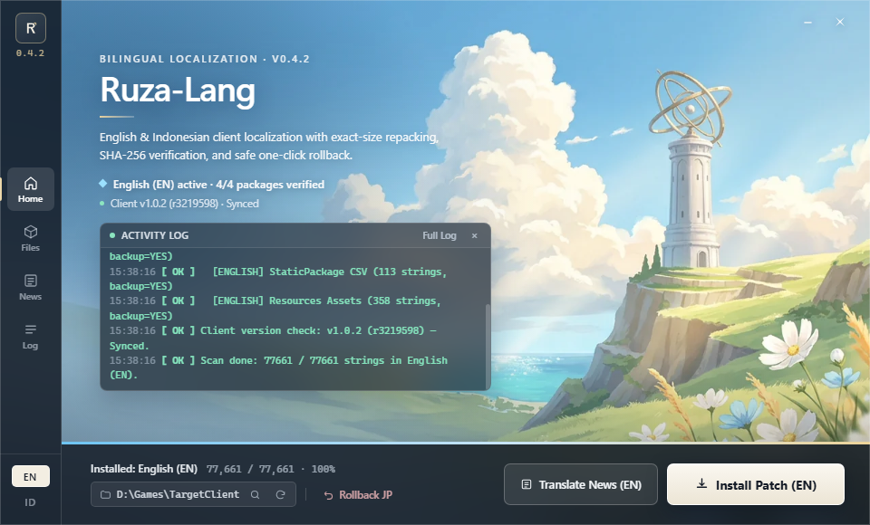

# Ruza-Lang (`v0.1.0`)

[](https://github.com/notnedar/ruza-lang/actions/workflows/release.yml)

> [!IMPORTANT]
> **Tested & Working In-Game · Vibe-Coded Educational Project**
> - Confirmed **tested and working in-game** on the current build.
> - This is a **vibe-coded educational project** — future client updates or hotfixes may still cause quirks or breaking changes. Always keep backups (`_ENPatchBackup\`) and use at your own risk.

An educational desktop localization & asset-repacking study project demonstrating bilingual string patching (**English** & **Bahasa Indonesia**), exact-size compressed bundle repacking, SHA-256 verification, and safe one-click rollback.

> **Pre-built Windows binary:** download `RuzaLangPatcher.exe` from [Releases](https://github.com/notnedar/ruza-lang/releases).

---

## Preview & Usage Demo

### Live Usage Walkthrough (`EN` ↔ `ID` + Rewrite Progress)


### Interface Screenshots

| English (`EN`) | Bahasa Indonesia (`ID`) |
| :---: | :---: |
|  |  |

### In-Game Sample (`EN`)


---

## Features / Fitur

- **Bilingual Switch (`EN` / `ID`):** Toggle between **English** and **Bahasa Indonesia** directly inside the GUI — switches both the app interface and the target localization pack.
- **4-Store Localization Pipeline (`77,661` strings):**
  - `VStringPool` — `74,055` strings (dialogue, quests, skills, items, settings)
  - `Static UI KeyConfig` — `3,135` strings (prefab labels, buttons, headers, notices)
  - `StaticPackage CSV` — `113` strings (startup & updater messages)
  - `resources.assets` — `358` strings (fallback startup & SDK UI)
- **Process Guard:** Checks whether target client/launcher processes are running and blocks patching or rollback until they are closed.
- **One-Click Rollback:** Saves verified original backups to `_ENPatchBackup\` before patching and restores exact original SHA-256 hashes anytime.
- **Exact-Size Asset Repacking:** Preserves identical file byte sizes across all 4 targets using exact-size LZ4HC tuning and round-trip integrity checks.
- **Live Terminal Log & Progress Counter:** Real-time rewrite counter (`0 → 77,661`) and per-target SHA-256 status badges.

---

## Usage / Cara Pakai

1. Make sure the target client and launcher are completely closed.
2. Download and run `RuzaLangPatcher.exe` from [Releases](https://github.com/notnedar/ruza-lang/releases).
3. Verify the auto-detected target directory (or click **Browse...** to select it manually).
4. Choose **`EN`** (English) or **`ID`** (Bahasa Indonesia) in the top-right toggle.
5. Click **Install / Rewrite** and wait ~2 seconds for verification to complete.
6. Click **Rollback to Original JP** at any time to restore the original files from backup.

---

## Repository Layout

- `src/` — Standalone desktop application & WebView2 dark UI (`src/ui/index.html`)
- `resources/` — Compressed bilingual localization payloads (`EN` + `ID`)
- `patches/` — Human-readable JSON translation dictionaries (`EN` + `ID`)
- `tools/` — Node.js scripts for payload packing and asset repacking research

---

## Build Transparency & Verification

Official release binaries are compiled directly on **GitHub Actions** (`windows-latest`) from this public source tree via [`.github/workflows/release.yml`](.github/workflows/release.yml) and signed with **GitHub Artifact Build Provenance Attestation**.

You can verify that a downloaded `RuzaLangPatcher.exe` was built directly by GitHub Actions from this repository:

```powershell
gh attestation verify RuzaLangPatcher.exe --owner notnedar
```

---

## Build from Source

Requires Windows 10/11 (x64), MSVC build tools, and Edge WebView2 Runtime:

```powershell
cargo build --release
```

Output executable: `target\release\RuzaLangPatcher.exe`

---

## Disclaimer

This repository is strictly an **educational project** created to study binary serialization, compression, and localization tooling. No copyrighted or proprietary assets are distributed here.
