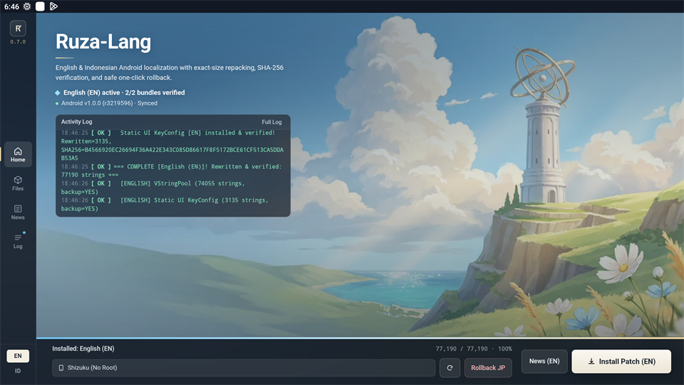
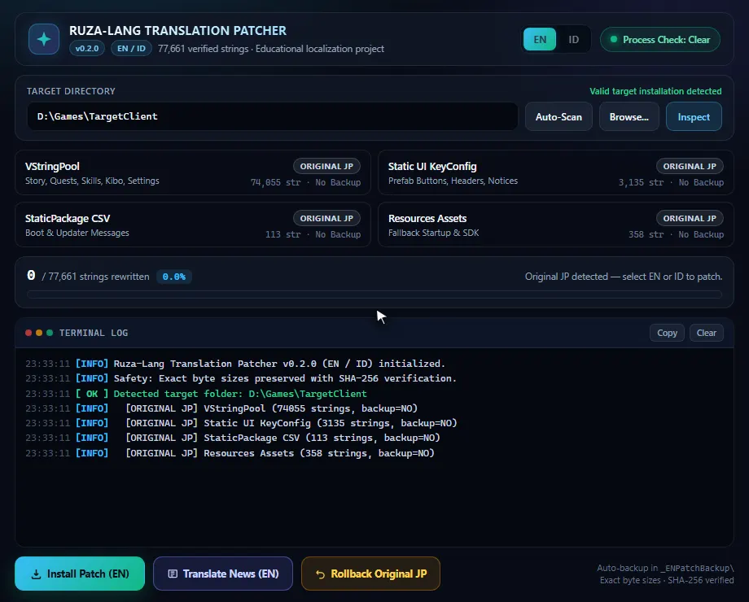
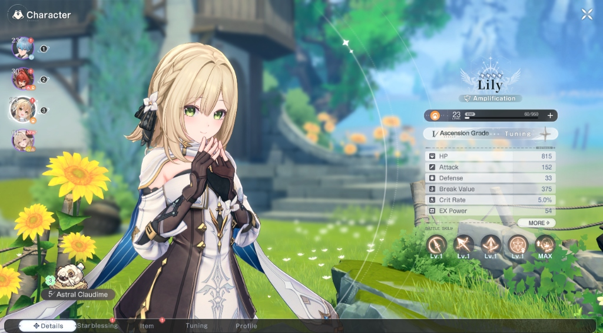
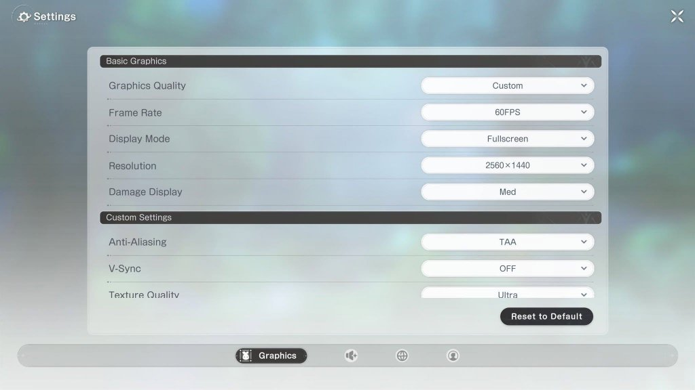

# Ruza-Lang (`v0.7.0`)

[](https://github.com/notnedar/ruza-lang/actions/workflows/release.yml)

> [!IMPORTANT]
> **Tested & Working In-Game (PC & Android) · Vibe-Coded Educational Project**
> - Confirmed **tested and working in-game** on both PC and Android clients (standalone APK & PC/ADB).
> - This is a **vibe-coded educational project** — future client updates or hotfixes may still cause quirks or breaking changes. Always keep automatic backups (`_ENPatchBackup\` / local APK backups) and use at your own risk.

An educational bilingual localization & asset-repacking suite demonstrating exact-size string patching (**English** & **Bahasa Indonesia**) for **Windows PC** and **Android** (both a **standalone zero-PC Android APK** and **PC-to-Android ADB**), SHA-256 verification, and safe one-click rollback.

> **Pre-built official binaries:** download **`RuzaLangPatcher.exe`** (Windows PC) or **`RuzaLangPatcher.apk`** (Standalone Android — no PC, no root!) from [Releases](https://github.com/notnedar/ruza-lang/releases).

---

## What's New in `v0.7.0`

- **Standalone Universal Android APK (`RuzaLangPatcher.apk`):** Patch directly on your Android phone with **no laptop, no root, and no APK re-signing**!
  - Responsive launcher-matched UI (**Portrait phone** top bar + bottom nav & **Landscape tablet/emulator** slim left rail) with the same scenic hero art, frosted-glass Settings cards, bilingual `EN`/`ID` switch, live Activity Log, and built-in Update Checker.
  - **Zero-PC Storage Access:** Supports **Shizuku** (Android 11–17 via on-phone Wireless Debugging), **SAF Folder Picker**, **Direct Storage**, and automatic **Root (`su`)** fallback, with an interactive bilingual **Setup Guide**.
  - **Fast Bit-Identical On-Device Patching (~3s):** Repacks **77,190 verified strings (`99.4%`: `VStringPool` + `Static UI KeyConfig`)** plus **Cached News (`EN` / `ID`)** directly on-device, with Process Guard, automatic local backups, atomic replacement + SHA-256 verification, and one-click **Rollback JP**.
- **Desktop Home Platform Selector (`PC` | `Android`) & Built-In ADB Connect Guide (`v0.6.1`):** Switch between **PC Client** and **Android (ADB)** right from the desktop bottom dock, with smart setup prompts, Wireless ADB (`IP:Port`), and a built-in bilingual USB/Wi-Fi/Emulator ADB guide.
- **Built-In Auto-Updater (`v0.5.0`):** Checks [GitHub Releases](https://github.com/notnedar/ruza-lang/releases/latest) automatically on launch (plus manual **Check Updates** in **Files**), verifies downloaded binaries against official `SHA256SUMS.txt`, and updates seamlessly.

---

## Preview & Usage Demo

### Standalone Android APK (`RuzaLangPatcher.apk` · Phone & Tablet)

| Portrait Phone (Home) | Portrait Phone (Files & Sync) |
| :---: | :---: |
|  |  |



### Desktop Live Usage Walkthrough (`EN` ↔ `ID` + Rewrite Progress)



### Desktop Interface Screenshots

| English (`EN`) | Bahasa Indonesia (`ID`) |
| :---: | :---: |
|  |  |


### In-Game Samples (`EN`)

| Character Screen | Star Journey Record |
| :---: | :---: |
|  |  |



---

## Features / Fitur

- **Bilingual Switch (`EN` / `ID`):** Toggle between **English** and **Bahasa Indonesia** directly inside the GUI (Windows & Android) — switches both the app interface and the target localization pack.
- **PC 4-Store Localization Pipeline (`77,661` strings):**
  - `VStringPool` — `74,055` strings (dialogue, quests, skills, items, settings)
  - `Static UI KeyConfig` — `3,135` strings (prefab labels, buttons, headers, notices)
  - `StaticPackage CSV` — `113` strings (startup & updater messages)
  - `resources.assets` — `358` strings (fallback startup & SDK UI)
- **Android 2-Bundle Pipeline (`77,190` strings · `99.4%` coverage):** `VStringPool` (`74,055`) + `Static UI KeyConfig` (`3,135`) + Android Cached News (`EN` / `ID`) — zero root and zero game APK re-signing.
- **Dedicated Translate News (`EN` / `ID`) Button:** Translates cached in-game announcement HTML pages (`16` pages in `HTTPCache` + `Library v3`) with automatic backup restore on Rollback.
- **Process Guard:** Checks whether target client/launcher processes are running (PC & Android) and blocks patching, news translation, or rollback until closed.
- **One-Click Rollback:** Saves verified original backups automatically before patching and restores exact original SHA-256 hashes anytime.
- **Exact-Size Asset Repacking:** Preserves identical file byte sizes across all targets using exact-size LZ4HC tuning and round-trip integrity checks.

---

## Usage / Cara Pakai

### Option A — Standalone Android Phone (No Laptop, No Root!)
1. Finish downloading the in-game additional data on Android, then **completely close (Force Stop) the game**.
2. Download and install **`RuzaLangPatcher.apk`** from [Releases](https://github.com/notnedar/ruza-lang/releases).
3. **Grant `Android/data` access (Android 11–17, zero PC, zero root):**
   - **Recommended — Shizuku via Wireless Debugging:**
     1. Install official **[Shizuku](https://shizuku.rikka.app/download/)** (Google Play or GitHub).
     2. Enable **Developer Options → Wireless Debugging** on your phone.
     3. Open Shizuku → tap **Pairing** → enter the 6-digit code in the notification → tap **Start**.
     4. Open **Ruza-Lang** → tap **Setup Access** → tap **Authorize Shizuku** → choose **Allow all the time**.
   - **Alternative — Folder Picker (SAF) / Direct Storage / Root:** Works directly on Android 8–12, compatible emulators, or rooted devices without Shizuku.
4. Choose **`EN`** (English) or **`ID`** (Bahasa Indonesia) in the top bar (or left rail on tablets/landscape).
5. Tap **Install Patch (`EN` / `ID`)** — takes ~3 seconds with automatic local backups and full SHA-256 verification.
6. Tap **Rollback JP** anytime to restore original files (including cached News if backed up).

### Option B — Windows PC Client
1. Make sure the target client and launcher are completely closed.
2. Download and run **`RuzaLangPatcher.exe`** from [Releases](https://github.com/notnedar/ruza-lang/releases).
3. Check the auto-detected target folder in the bottom dock (or click the path / open **Files** to browse manually).
4. Choose **`EN`** or **`ID`** at the bottom of the left rail and click **Install Patch**.
5. *(Optional)* After opening the in-game News/Announcements screen once, close the client and click **Translate News (`EN` / `ID`)**.
6. Click **Rollback JP** anytime to restore original files.

### Option C — Patch Android from Windows PC (ADB: USB / Wi-Fi / Emulator)
Works on any real Android phone (USB or Android 11+ Wireless Debugging) or Windows Android emulator (BlueStacks, LDPlayer, MuMu, MEmu, Nox):
1. Finish downloading in-game data and **completely close the game** on Android.
2. Enable **USB Debugging** (or **Wireless Debugging** / Emulator ADB setting) and connect to your PC.
3. Open `RuzaLangPatcher.exe`, switch the bottom dock toggle to **Android** (or click **ADB Guide `?`** for step-by-step setup & Wireless `IP:Port` connect), choose **`EN`** or **`ID`**, and click **Install Patch**.

---

## Repository Layout

- `src/` — Standalone Windows desktop launcher & frameless WebView2 UI (`src/ui/index.html`, `src/ui/hero.webp`)
- `android/` — Standalone universal Android APK project (Kotlin + Shizuku AIDL + responsive WebView UI)
- `resources/` — Shared compressed bilingual localization payloads (`EN` + `ID`, used by both PC and Android builds)
- `patches/` — Human-readable JSON translation dictionaries (`EN` + `ID`)
- `tools/` — Node.js scripts for payload packing and asset repacking research

---

## Build Transparency & Verification

Official release binaries (`RuzaLangPatcher.exe` and `RuzaLangPatcher.apk`) are compiled directly on **GitHub Actions** (`windows-latest` & `ubuntu-latest`) from this public source tree via [`.github/workflows/release.yml`](.github/workflows/release.yml) and signed with **GitHub Artifact Build Provenance Attestation**.

Verify both binaries locally:

```bash
gh attestation verify RuzaLangPatcher.exe --owner notnedar
gh attestation verify RuzaLangPatcher.apk --owner notnedar
```

---

## Build from Source

### Windows PC Executable
Requires Windows 10/11 (x64), MSVC build tools, and Edge WebView2 Runtime:

```powershell
cargo build --release
```

Output: `target\release\RuzaLangPatcher.exe`

### Standalone Android APK
Requires JDK 17 and Android SDK (Platform 36):

```bash
cd android
./gradlew testDebugUnitTest assembleRelease
```

Output: `android/app/build/outputs/apk/release/app-release.apk`

---

## Disclaimer

This repository is strictly an **educational project** created to study binary serialization, compression, and localization tooling. No copyrighted or proprietary assets are distributed here.
