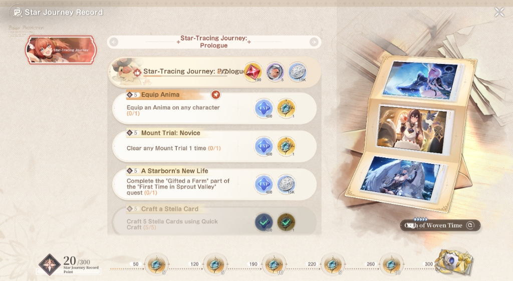

# Ruza-Lang (`v0.6.1`)

[](https://github.com/notnedar/ruza-lang/actions/workflows/release.yml)

> [!IMPORTANT]
> **Tested & Working In-Game (PC & Android) · Vibe-Coded Educational Project**
> - Confirmed **tested and working in-game** on both PC and Android clients.
> - This is a **vibe-coded educational project** — future client updates or hotfixes may still cause quirks or breaking changes. Always keep automatic backups (`_ENPatchBackup\` / `%LOCALAPPDATA%\RuzaLang\AndroidBackups\`) and use at your own risk.

An educational desktop localization & asset-repacking study project demonstrating bilingual string patching (**English** & **Bahasa Indonesia**) for **PC and Android (ADB)**, exact-size compressed bundle repacking, SHA-256 verification, and safe one-click rollback.

> **Pre-built Windows binary:** download `RuzaLangPatcher.exe` from [Releases](https://github.com/notnedar/ruza-lang/releases).

---

## What's New in `v0.6.1`

- **Home Dock Platform Selector (`PC` | `Android`):** Switch directly between **PC Client** and **Android (ADB)** right from the bottom launcher dock on Home. Hero status, client version sync, progress bar, **Install Patch**, **Translate News**, and **Rollback JP** all adapt automatically to the selected platform.
- **Smart Missing-Install & Setup Prompts:** Clearly guides you when the PC folder isn't detected (**Browse Folder** / **Auto-Scan** / **Switch to Android**) or when Android ADB / device / client app / in-game asset bundles aren't ready yet (**ADB Connect Guide** / **Choose Device** / **Browse `adb.exe`** / **Switch to PC**).
- **Built-In ADB Connect Guide & Wireless IP Connect:** In-app bilingual (**EN** / **ID**) step-by-step guide covering **real Android phones via USB cable**, **Android 11+ Wireless Debugging (`IP:Port` connect)**, **Windows Android emulators** (BlueStacks / LDPlayer / MuMu), and a direct link to Google **Android SDK Platform-Tools**.
- **Android (ADB) Patching Mode (`v0.6.0`):** Patches Android devices & emulators over ADB with **zero root and zero APK re-signing** — **77,190 verified strings (`99.4%`: `VStringPool` + `Static UI KeyConfig`)** plus **Android Cached News (`EN` / `ID`)**, Android Process Guard (`pidof`), PC backups in `%LOCALAPPDATA%\RuzaLang\AndroidBackups\`, atomic transfer + remote `sha256sum` verification, and one-click **Rollback JP**.
- **Built-In Auto-Updater (`v0.5.0`):** Checks [GitHub Releases](https://github.com/notnedar/ruza-lang/releases/latest) automatically on launch (plus manual **Check Updates** in **Files**), verifies downloaded binaries against official `SHA256SUMS.txt` over allowlisted HTTPS, swaps the executable atomically in-place, and relaunches automatically.

---

## Preview & Usage Demo

### Live Usage Walkthrough (`EN` ↔ `ID` + Rewrite Progress)


### Interface Screenshots

| English (`EN`) | Bahasa Indonesia (`ID`) |
| :---: | :---: |
|  |  |

### Android (ADB) Mode


### In-Game Samples (`EN`)

| Character Screen | Star Journey Record |
| :---: | :---: |
|  |  |


---

## Features / Fitur

- **Bilingual Switch (`EN` / `ID`):** Toggle between **English** and **Bahasa Indonesia** directly inside the GUI — switches both the app interface and the target localization pack.
- **4-Store Localization Pipeline (`77,661` strings):**
  - `VStringPool` — `74,055` strings (dialogue, quests, skills, items, settings)
  - `Static UI KeyConfig` — `3,135` strings (prefab labels, buttons, headers, notices)
  - `StaticPackage CSV` — `113` strings (startup & updater messages)
  - `resources.assets` — `358` strings (fallback startup & SDK UI)
- **Dedicated Translate News (`EN` / `ID`) Button:** Translates cached in-game announcement HTML pages (`16` pages in `AppData\LocalLow\...\HTTPCache`) with automatic backup in `_NewsPatchBackup\` while preserving HTTP `ETag`/`Last-Modified` headers and syncing BestHTTP `Library` body lengths.
- **Process Guard:** Checks whether target client/launcher processes are running and blocks patching, news translation, or rollback until they are closed.
- **One-Click Rollback:** Saves verified original backups to `_ENPatchBackup\` (and `_NewsPatchBackup\` for cached announcements) before patching and restores exact original SHA-256 hashes anytime.
- **Exact-Size Asset Repacking:** Preserves identical file byte sizes across all 4 targets using exact-size LZ4HC tuning and round-trip integrity checks.
- **Live Verification Log & Progress Rail:** Real-time rewrite progress (`0 → 77,661`) along the launcher dock, per-package SHA-256 verification rows in the `Files` view, and a clean execution ledger in the `Log` view.

---

## Usage / Cara Pakai

### PC Client
1. Make sure the target client and launcher are completely closed.
2. Download and run `RuzaLangPatcher.exe` from [Releases](https://github.com/notnedar/ruza-lang/releases).
3. Check the auto-detected target folder in the bottom dock (or click the path / open **Files** to browse manually).
4. Choose **`EN`** (English) or **`ID`** (Bahasa Indonesia) at the bottom of the left rail.
5. Click **Install Patch** in the bottom-right dock and wait ~2 seconds for verification to complete.
6. *(Optional)* After opening the in-game News/Announcements screen at least once, close the client and click **Translate News (`EN` / `ID`)** to translate cached in-game announcements.
7. Click **Rollback JP** at any time to restore original files (including cached News if backed up).

### Android (Real Phone via USB / Wi-Fi ADB, or Emulator)
Works on **any real Android phone** (no root, no APK re-sign) as well as Windows Android emulators (BlueStacks, LDPlayer, MuMu, MEmu, Nox):

1. Finish downloading the in-game additional data on Android, then **completely close the game** on your phone/emulator.
2. **How to connect ADB:**
   - **Real Android Phone (USB Cable — Recommended):**
     1. Open **Settings → About Phone** and tap **Build Number** 7 times to unlock Developer Options.
     2. Open **Settings → System → Developer Options** and enable **USB Debugging**.
     3. Plug your phone into your PC with a data USB cable, unlock the screen, and tap **Allow** on the USB Debugging prompt.
   - **Real Android Phone (Wi-Fi — Android 11+ Wireless Debugging):**
     1. Enable **Developer Options → Wireless Debugging** (pair once with PC or via USB first).
     2. In Ruza-Lang, click **ADB Guide** (`?`) → enter the `IP:Port` shown on your phone → click **Connect IP**.
   - **Windows Emulator (BlueStacks / LDPlayer / MuMu):**
     - Enable **Android Debug Bridge (ADB)** in emulator Settings (BlueStacks: *Settings → Advanced → ADB ON*).
   - **No `adb.exe` on PC yet?** Download official [Google Android SDK Platform-Tools](https://developer.android.com/tools/releases/platform-tools) and extract `adb.exe` (+ DLLs) right next to `RuzaLangPatcher.exe` (or click **ADB** in the **Android** tab to pick it).
3. Open `RuzaLangPatcher.exe`, switch the bottom dock toggle to **Android** (or open the **Android** tab), choose **`EN`** or **`ID`**, and click **Scan**.
4. Click **Install Patch (`EN` / `ID`)** — original bundles are backed up to `%LOCALAPPDATA%\RuzaLang\AndroidBackups\`, patched exact-size, pushed atomically, and verified via remote `sha256sum`.
5. Click **Rollback JP** anytime to restore Android back to Original JP.

---

## Repository Layout

- `src/` — Standalone desktop launcher & frameless WebView2 UI (`src/ui/index.html`, `src/ui/hero.webp`)
- `resources/` — Compressed bilingual localization payloads (`EN` + `ID`)
- `patches/` — Human-readable JSON translation dictionaries (`EN` + `ID`)
- `tools/` — Node.js scripts for payload packing and asset repacking research

---

## Build Transparency & Verification

Official release binaries are compiled directly on **GitHub Actions** (`windows-latest`) from this public source tree via [`.github/workflows/release.yml`](.github/workflows/release.yml) and signed with **GitHub Artifact Build Provenance Attestation**.

You can verify that a downloaded `RuzaLangPatcher.exe` was built directly by GitHub Actions from this repository:

```powershell
gh attestation verify RuzaLangPatcher.exe --owner notnedar
```

---

## Build from Source

Requires Windows 10/11 (x64), MSVC build tools, and Edge WebView2 Runtime:

```powershell
cargo build --release
```

Output executable: `target\release\RuzaLangPatcher.exe`

---

## Disclaimer

This repository is strictly an **educational project** created to study binary serialization, compression, and localization tooling. No copyrighted or proprietary assets are distributed here.
