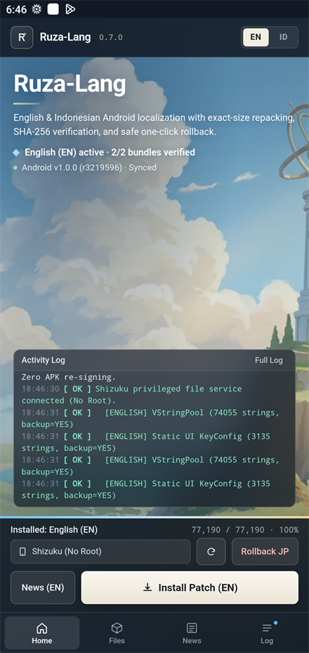
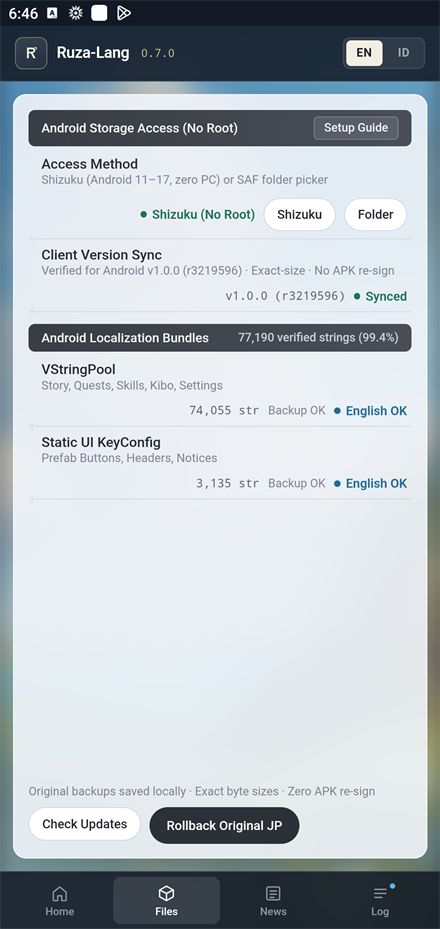
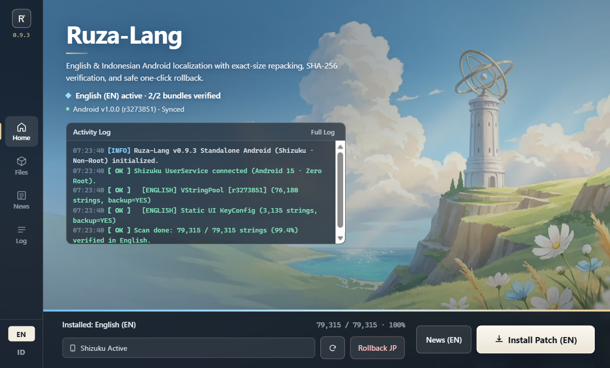
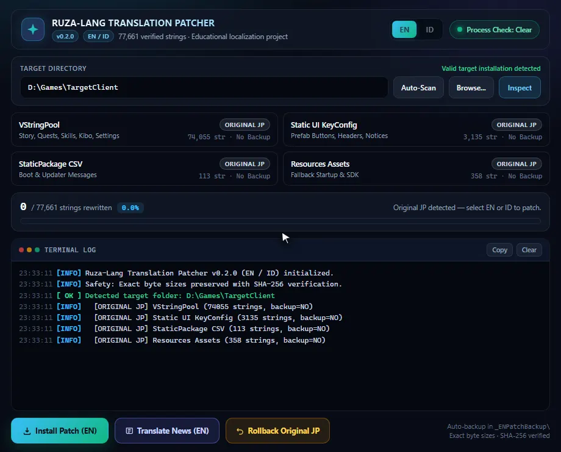
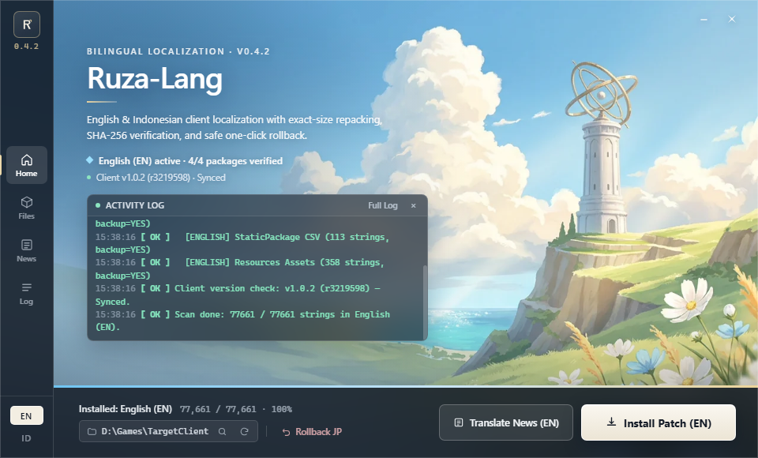
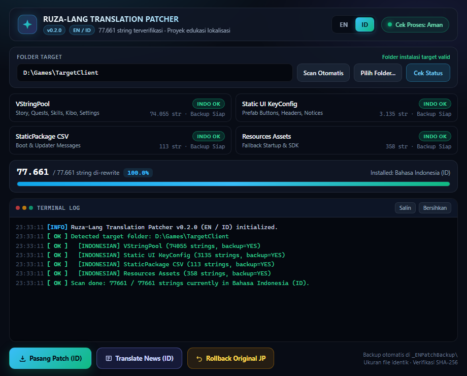
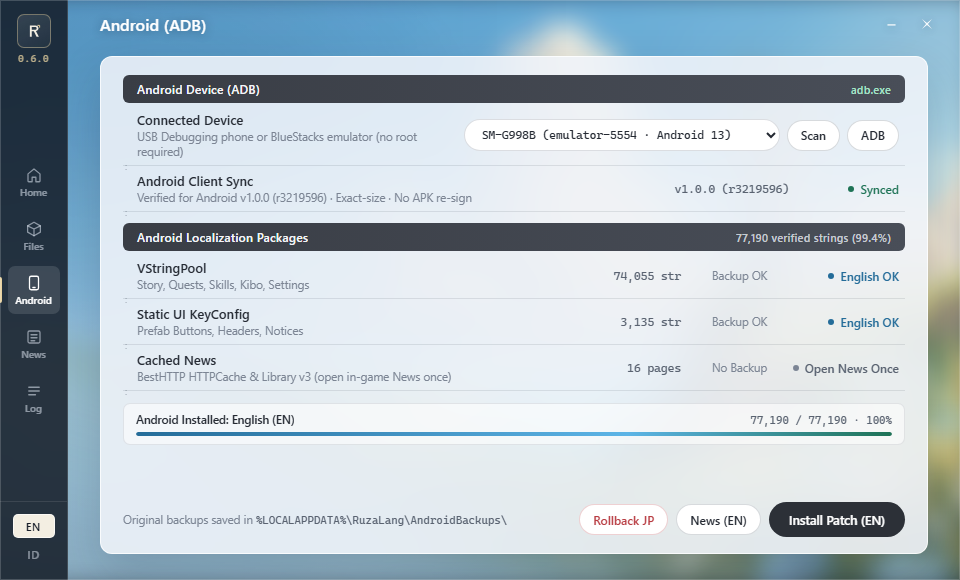
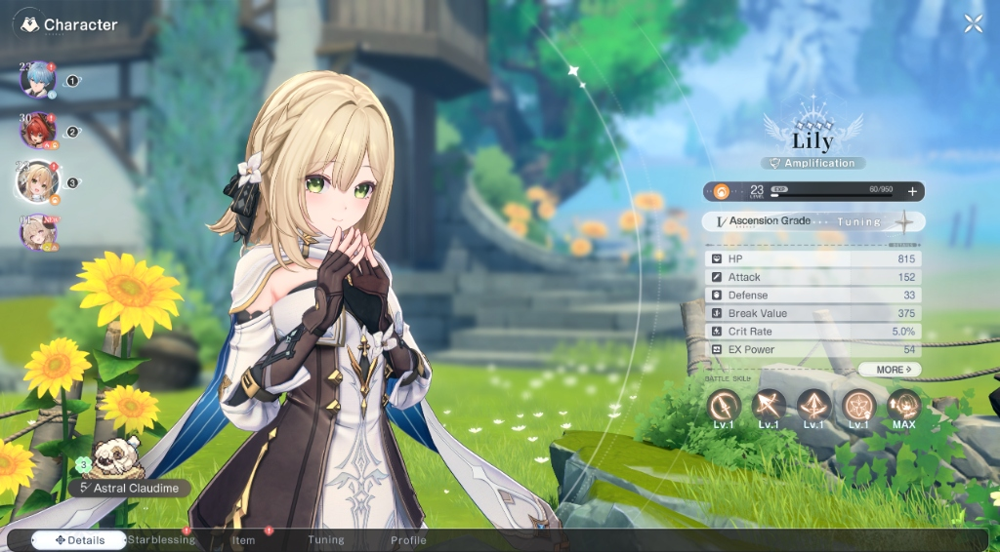
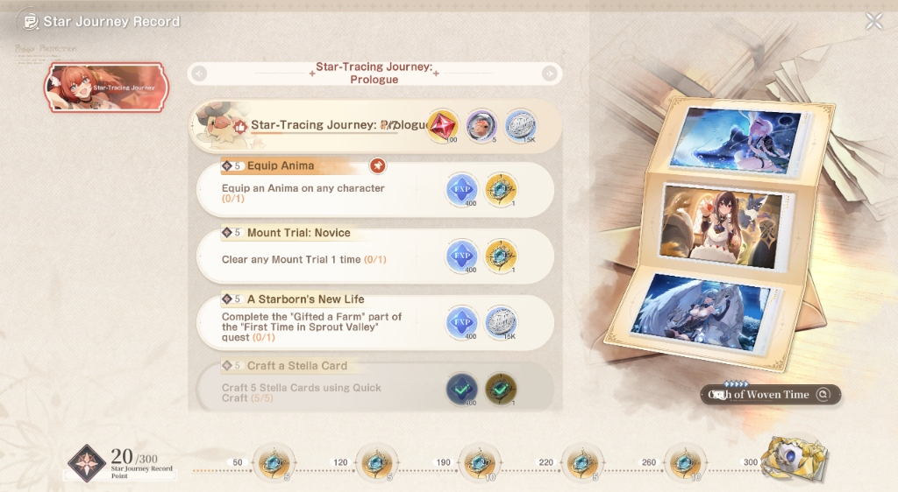
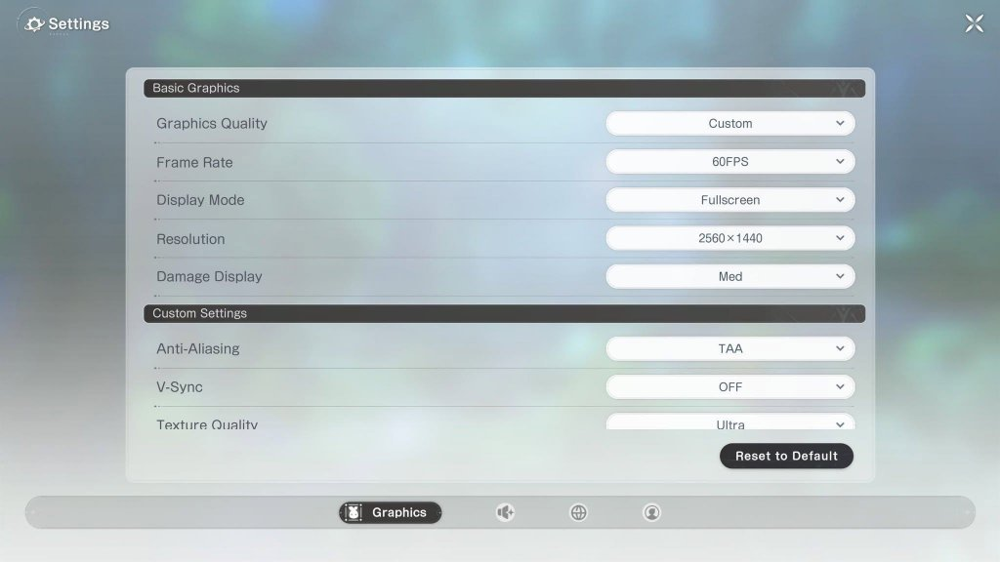

# Ruza-Lang (`v0.9.2`)

🌐 **Bahasa:** [English (`README.md`)](README.md) | **Bahasa Indonesia**

[](https://github.com/notnedar/ruza-lang/actions/workflows/release.yml)

> [!IMPORTANT]
> **Sudah Dites & Jalan di Dalam Game (PC & Android) · Proyek Edukasi Vibe-Coded**
> - Sudah **dites langsung dan berjalan normal di dalam game** pada klien PC maupun Android (APK standalone & PC/ADB).
> - Ini adalah **proyek edukasi vibe-coded** — update besar atau hotfix game di masa depan tetap bisa saja menimbulkan quirk atau perubahan struktur. Selalu simpan backup otomatis (`_ENPatchBackup\` / backup lokal APK) dan gunakan dengan risiko masing-masing.

Suite lokalisasi & asset-repacking edukasional dengan ukuran byte identik (**Bahasa Inggris**, **Bahasa Indonesia**, serta **Bring Your Own Custom Language Pack**) untuk **Windows PC** dan **Android** (tersedia **APK Android standalone tanpa PC** maupun lewat **PC-to-Android ADB**), lengkap dengan verifikasi SHA-256 dan rollback sekali klik.

> **Download binary resmi siap pakai:** ambil **`RuzaLangPatcher.exe`** (Windows PC) atau **`RuzaLangPatcher.apk`** (Android Standalone — 100% tanpa PC & tanpa root!) di halaman [Releases](https://github.com/notnedar/ruza-lang/releases).

---

## Yang Baru di `v0.9.2`

- **Opsi Font UI PC Ringkas (`Compact font (PC Only)`):** Checkbox langsung di atas tombol **Pasang Patch** pada halaman Utama. Mengganti glyph Latin di seluruh paket font UI PC aktif ke **Barlow Semi Condensed** (~15% lebih ramping agar teks Inggris/Indonesia lebih lega di tombol & menu) sambil menjaga seluruh glyph CJK/JP tetap utuh (bebas kotak `□□□`), ukuran file identik (`0 B` delta), backup asli otomatis, dan otomatis kembali ke font bawaan saat centang dimatikan atau saat **Rollback JP**.
- **Perbaikan Loading Screen Tips (`EN` & `ID`):** Membagi seluruh tips loading screen yang terlalu panjang menjadi 2 baris seimbang agar tidak keluar batas layar, serta merapikan istilah resmi (`Astral Insight`, `Star Journey Record`, `Level Astrologi`).
- **Perbaikan Tombol UI Gacha & Koneksi Shizuku HyperOS (`v0.9.1`):** Merapikan tombol Gacha agar tidak terpotong (`1x Observasi`, `10x Observasi`, `Penukaran`, `Detail`), menambah polling `2 detik` + panduan Shizuku HyperOS/ColorOS, dan menambahkan dokumentasi penuh Bahasa Indonesia.
- **Engine Universal Anti-Hotfix (`v0.9.0` · `PC` & `Android`):**
  - **Auto-Discovery Bundle Dinamis:** Otomatis mendeteksi file `.r` aktif untuk `VStringPool` (`raw_base_package`) dan `Static UI KeyConfig` (`default_package`, lewat signature Unity CAB) di PC maupun Android (Shizuku, SAF, Direct, dan ADB) — tidak lagi bergantung pada nama file `.r` atau offset hardcoded!
  - **Matching Berbasis Content-Hash Universal (`RZV2`):** Mencocokkan seluruh **`76.180`** string `VStringPool` menggunakan hash `FNV-1a64` + panjang byte dengan dynamic contiguous span repacking — otomatis jalan mulus di `r3219596`, `r3219598`, `r3273851`, `r3273853`, hingga hotfix resource berikutnya!
  - **Smart Hotfix Version Sync:** Otomatis menyinkronkan hotfix resource yang kompatibel (tidak ada lagi popup palsu *Client Version Mismatch* di `r3273851` / `r3273853`+) sambil menyimpan status per-bundle (`_ruza_state.json`) dan backup `<nama_bundle>.original`.
- **Translasi Penuh Hotfix `r3273853` / `r3273851` (`+2.125` String Baru `EN` & `ID`):**
  - Seluruh **`2.125`** string baru dari hotfix terbaru sudah diterjemahkan ke **Bahasa Inggris (`EN`)** dan **Bahasa Indonesia (`ID`)**, menjadikan total cakupan **`79.786` string di PC** dan **`79.315` string di Android (`99,4%`)**.
  - Label `Static UI KeyConfig` Bahasa Indonesia dirapikan agar muat sempurna di budget LZ4HC exact-size `r3273853` dengan slack aman di `EN` maupun `ID`.
- **Pembaruan Sebelumnya (`v0.8.1` & `v0.8.0`):**
  - **Kunci Tombol Otomatis Saat Game Berjalan (`v0.8.1`):** Otomatis menonaktifkan **Pasang Patch**, **Translate News**, dan **Rollback JP** (menampilkan `Tutup Game Dulu`) selama game atau launcher masih aktif di PC, Android ADB, maupun APK Android.
  - **Paket Bahasa Kustom (`BYOL` · `v0.8.0`):** Muat file `.json` bahasamu sendiri langsung dari **Paket → Paket Bahasa Kustom → Muat JSON** (mendukung status `Custom OK`, fallback bahasa dasar `en`/`id`/`jp`, drop-in kamus flat, plus panduan [`CONTRIBUTING.md`](CONTRIBUTING.md) & validator `node tools/validate-pack.mjs`).
  - **Perbaikan Istilah Timing Combat & Glosarium Resmi (`v0.8.0` / `v0.7.1`):** Istilah action-RPG natural (`Perfect Guard`, `Perfect Parry`, `Perfect Dodge`, `Celah Parry`), `3.362` istilah resmi global, serta APK Android `100%` non-root.

---

## Preview & Demo Pemakaian

### APK Android Standalone (`RuzaLangPatcher.apk` · HP & Tablet)

| HP Portrait (Utama) | HP Portrait (Paket & Sinkron) |
| :---: | :---: |
|  |  |



### Demo Pemakaian Desktop (`EN` ↔ `ID` + Progres Rewrite)



### Tampilan Antarmuka Desktop

| English (`EN`) | Bahasa Indonesia (`ID`) |
| :---: | :---: |
|  |  |



### Contoh Tampilan di Dalam Game (`EN`)

| Menu Karakter | Catatan Perjalanan Bintang |
| :---: | :---: |
|  |  |



---

## Fitur Utama

- **Ganti Bahasa Instan (`EN` / `ID`):** Pilih **English** atau **Bahasa Indonesia** langsung di dalam aplikasi (Windows & Android) — mengubah bahasa antarmuka aplikasi sekaligus bahasa patch target.
- **Pipeline 4-Store PC (`79.786` string):**
  - `VStringPool` — `76.180` string (dialog, quest, skill, item, pengaturan — dicocokkan lewat content-hash anti-hotfix)
  - `Static UI KeyConfig` — `3.135` string (tombol prefab, tab, header, notifikasi — dideteksi dinamis)
  - `StaticPackage CSV` — `113` string (pesan boot & updater)
  - `resources.assets` — `358` string (fallback startup & SDK UI)
- **Pipeline 2-Bundle Android (`79.315` string · cakupan `99,4%`):** `VStringPool` (`76.180`) + `Static UI KeyConfig` (`3.135`) + Cache Berita Android (`EN` / `ID`) — tanpa root, tanpa re-sign APK game, dan sinkron otomatis terhadap hotfix.
- **Tombol Translate News (`EN` / `ID`):** Menerjemahkan halaman HTML pengumuman in-game yang tersimpan di cache (`16` halaman di `HTTPCache` + `Library v3`), ikut kembali ke asli saat Rollback.
- **Process Guard Aktif:** Mendeteksi apakah game atau launcher sedang berjalan (PC & Android) lalu mengunci tombol patch, news, dan rollback sampai game ditutup penuh.
- **Rollback Sekali Klik:** Backup file asli otomatis disimpan sebelum patch pertama dan dapat dikembalikan ke Original JP kapan saja dengan verifikasi SHA-256.
- **Repacking Ukuran Byte Identik:** Menjaga ukuran file aset 100% sama persis menggunakan kompresi LZ4HC exact-size dan verifikasi round-trip.

---

## Cara Pakai

### Opsi A — HP Android Standalone (Tanpa Laptop, Tanpa Root!)
1. Pastikan download data tambahan di dalam game sudah selesai, lalu **tutup paksa (Force Stop) game sampai benar-benar berhenti**.
2. Download dan install **`RuzaLangPatcher.apk`** dari [Releases](https://github.com/notnedar/ruza-lang/releases).
3. **Berikan izin akses `Android/data` (Android 11–17, tanpa PC, tanpa root):**
   - **Disarankan — Shizuku via Wireless Debugging:**
     1. Install aplikasi resmi **[Shizuku](https://shizuku.rikka.app/download/)** (Play Store atau GitHub).
     2. Aktifkan **Opsi Pengembang → Wireless Debugging (Proses debug nirkabel)** di HP kamu (harus terhubung ke Wi-Fi).
     3. Buka Shizuku → ketuk **Pairing** → masukkan kode 6 digit di notifikasi → ketuk **Start** sampai muncul status **"Shizuku is running"**.
     4. Buka **Ruza-Lang** → ketuk **Atur Akses** → ketuk **Izinkan Shizuku** → pilih **Izinkan sepanjang waktu (Allow all the time)**.
   - **Alternatif — Pilih Folder (SAF) / Direct Storage:** Berjalan langsung di Android 8–12 atau emulator yang kompatibel tanpa Shizuku (100% non-root). *(Catatan: Android 13–17 memblokir SAF dari folder `Android/data`, jadi gunakan Shizuku atau Opsi C di bawah.)*
   - **Tips Khusus HP Xiaomi / POCO / Redmi (HyperOS) & OPPO / Realme:** Jika Shizuku sudah jalan tapi Ruza-Lang masih menampilkan *Berikan Izin Akses Storage Dulu*:
     - **Xiaomi / POCO / Redmi (HyperOS):** Di *Opsi Pengembang*, wajib aktifkan **USB debugging (Security settings / Pengaturan keamanan)**. Lalu buka *Pengaturan → Aplikasi → Kelola aplikasi* untuk **Shizuku** dan **Ruza-Lang**: ubah **Baterai → Tanpa pembatasan (No restrictions)**, aktifkan **Autostart**, dan kunci **Shizuku** di Recent Apps agar tidak dimatikan HyperOS.
     - **OPPO / OnePlus / Realme:** Aktifkan **Nonaktifkan pemantauan izin (Disable permission monitoring)** di bagian bawah *Opsi Pengembang*.
4. Pilih **`EN`** (English) atau **`ID`** (Bahasa Indonesia) di bar atas (atau rail kiri pada mode tablet/landscape).
5. Ketuk **Pasang Patch (`EN` / `ID`)** — selesai dalam ~3 detik lengkap dengan backup lokal dan verifikasi SHA-256.
6. Ketuk **Rollback JP** kapan saja untuk mengembalikan file asli (termasuk cache Berita jika ada backup).

### Opsi B — Klien Windows PC
1. Pastikan game dan launcher sudah ditutup sepenuhnya.
2. Download dan jalankan **`RuzaLangPatcher.exe`** dari [Releases](https://github.com/notnedar/ruza-lang/releases).
3. Cek folder game yang terdeteksi otomatis di dock bawah (atau klik path / buka tab **Paket** untuk memilih folder instalasi game secara manual).
4. Pilih **`EN`** atau **`ID`** di pojok kiri bawah, lalu klik **Pasang Patch**.
5. *(Opsional)* Setelah membuka menu Berita/Pengumuman di dalam game minimal sekali, tutup game lalu klik **Translate News (`EN` / `ID`)**.
6. Klik **Rollback JP** kapan saja untuk kembali ke bahasa Jepang asli.

### Opsi C — Patch HP Android dari PC Windows (ADB: USB / Wi-Fi / Emulator)
Cocok untuk HP Android apa pun (termasuk jika HyperOS memblokir Shizuku) atau emulator Android di PC (BlueStacks, LDPlayer, MuMu, MEmu, Nox):
1. Selesaikan download data in-game dan **tutup game sepenuhnya** di Android.
2. Aktifkan **USB Debugging** (atau **Wireless Debugging** / pengaturan ADB emulator), lalu hubungkan ke PC.
3. Buka `RuzaLangPatcher.exe`, ubah toggle di dock bawah ke **Android** (atau klik tombol **Panduan ADB `?`** untuk panduan lengkap & konek Wi-Fi `IP:Port`), pilih **`EN`** atau **`ID`**, lalu klik **Pasang Patch**.

### Opsi D — Bawa Paket Bahasa Sendiri (BYOL) & Kontribusi Bahasa
Mau main pakai bahasa lain (Spanyol, Portugis, Prancis, Vietnam, Thailand, Rusia, bahasa daerah, atau ubah istilah sendiri), atau mau bantu perbaiki terjemahan `EN` / `ID`?
- **Suruh AI Agent / Gemini / ChatGPT yang Kerjain:** Kita hidup di zaman LLM udah jago banget buat ini — **pakai aja.** Enggak perlu nyiksa diri menerjemahkan 79.000 baris manual di Notepad; tinggal kasih link repo ini (`https://github.com/notnedar/ruza-lang`) ke AI agent, **Gemini**, atau **ChatGPT** pakai prompt copy-paste di **[`CONTRIBUTING.md`](CONTRIBUTING.md)**, lalu validasi hasilnya pakai `node tools/validate-pack.mjs`.
- **Langsung Pasang 1 Klik (PC & Android):** Buka **Paket → Paket Bahasa Kustom → Muat JSON** di **Windows PC** maupun **APK Android**, lalu klik **Pasang Patch (`<KODE>`)**! Satu file `.json` otomatis jalan di PC dan Android (atur `"base": "en"`, `"id"`, atau `"jp"` untuk string yang belum diterjemahkan).
- **Ikut Kontribusi:** Kirim Pull Request untuk perbaikan `EN`/`ID` atau paket bahasa komunitas — baca detail lengkapnya di **[`CONTRIBUTING.md`](CONTRIBUTING.md)**.

---

## Struktur Repositori

- `src/` — Aplikasi launcher desktop Windows & antarmuka frameless WebView2 (`src/ui/index.html`, `src/ui/hero.webp`)
- `android/` — Proyek APK Android universal standalone (Kotlin + Shizuku AIDL + WebView responsif HP & tablet)
- `resources/` — Payload lokalisasi terkompresi bersama (`EN` + `ID`, dipakai bersama oleh build PC dan Android)
- `patches/` — Kamus terjemahan JSON yang mudah dibaca dan diedit (`EN` + `ID`)
- `tools/` — Skrip Node.js untuk packing payload, validasi paket bahasa, dan riset repacking aset

---

## Transparansi Build & Verifikasi

Semua binary resmi (`RuzaLangPatcher.exe` dan `RuzaLangPatcher.apk`) dikompilasi langsung di server **GitHub Actions** (`windows-latest` & `ubuntu-latest`) dari source code publik di repositori ini lewat [`.github/workflows/release.yml`](.github/workflows/release.yml) dan ditandatangani dengan **GitHub Artifact Build Provenance Attestation**.

Kamu bisa verifikasi keaslian kedua file secara lokal:

```bash
gh attestation verify RuzaLangPatcher.exe --owner notnedar
gh attestation verify RuzaLangPatcher.apk --owner notnedar
```

---

## Build dari Source Code

### Executable Windows PC
Membutuhkan Windows 10/11 (x64), MSVC build tools, dan Edge WebView2 Runtime:

```powershell
cargo build --release
```

Output: `target\release\RuzaLangPatcher.exe`

### APK Android Standalone
Membutuhkan JDK 17 dan Android SDK (Platform 36):

```bash
cd android
./gradlew testDebugUnitTest assembleRelease
```

Output: `android/app/build/outputs/apk/release/app-release.apk`

---

## Disclaimer

Repositori ini dibuat murni sebagai **proyek edukasi** untuk mempelajari serialisasi biner, kompresi aset, dan perkakas lokalisasi. Tidak ada aset berhak cipta atau file proprietary yang didistribusikan di sini.
